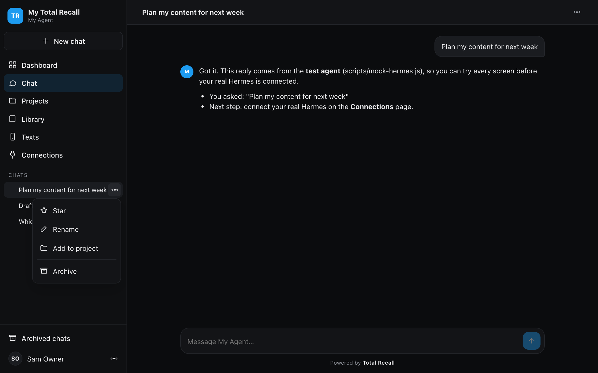

# Total Recall Starter

A starting platform for your own Total Recall: a private web app where you sign in, see your dashboard, and chat with **your own Hermes agent**. You own all of it: your GitHub, your Railway, your database, your keys.



## What you get

- **Sign in** with your own owner account (hashed password, secure cookie, rate-limited).
- **Dashboard** cards that say where each number came from and when it was updated. Cards with no data say "Needs a source", never fake zeros. Your agent can post its own cards on a schedule.
- **Chat with your Hermes** through its official runs API. You see replies as they arrive and a "working" status while it uses tools. You can stop a reply, and a refresh or redeploy never loses an answer.
- **Approval cards** appear only when Hermes really asks. You approve or deny, and nothing is ever approved for you.
- **Smart chat names.** A new chat gets a short, clear name after the first reply, then a better one once the chat grows. A name you set yourself is never replaced.
- **The three-dot menu** on every chat: **Star**, **Rename**, **Add to project**, **Archive**.
- **Archive instead of delete.** Archived chats leave your sidebar. In **Archived chats** you can restore one or delete it forever.
- **Projects** group your chats. Deleting a project keeps its chats.
- **Texts** through your own Telnyx number: signed webhooks, STOP handling, honest delivery statuses, and a confirm step before every send. Sending stays off until your number is approved.
- **Connections** shows your agent, library, texting and Composio apps. You can link new apps (Gmail, Calendar, Drive, CRMs...) through your own Composio project.
- **Library** search over the memory service your Hermes already uses, with links to the sources.
- **Settings** to make it yours: app name, agent name, logo letters, accent colour, light or dark, home page, and a menu you can rename, reorder and hide. You can also add your own pages and links.
- **Powered by Total Recall** under the chat box.
- It works on your phone (add it to your home screen).

## What it needs

1. Node 20 or newer.
2. A Postgres database (Railway Postgres is perfect).
3. Your Hermes running with its API server on (`API_SERVER_ENABLED=true` and a strong `API_SERVER_KEY`), reachable from where this app runs.

Optional: a Telnyx number, a Composio project, an OpenAI key for chat names, and your memory service's search URL.

## Quick start (local)

```bash
npm install
cp .env.example .env      # fill in DATABASE_URL, HERMES_API_URL, HERMES_API_KEY
npm run create-owner -- you@example.com "Your Name"
npm run check
npm start                 # http://localhost:3000
```

## Deploy on Railway

1. Create this repo in your own GitHub (the green **Use this template** button), and make it private.
2. In Railway, create a project and add **Postgres**, then add a service from your GitHub repo.
3. In the service's **Variables**, add `DATABASE_URL` (a reference to your Postgres), `HERMES_API_URL`, `HERMES_API_KEY` and `NODE_ENV=production`. See [docs/ENV.md](docs/ENV.md).
4. Generate a domain under **Settings > Networking**.
5. Create your login from your computer: `railway run npm run create-owner -- you@example.com "Your Name"`.

The app creates its tables on every start (safe to repeat) and answers health checks at `/healthz`.

## Guides

- [docs/CODEX-GUIDE.md](docs/CODEX-GUIDE.md): the step-by-step guide your builder (Codex) follows to install, connect and customize this. It also covers bringing this layout into a platform you already built.
- [docs/CUSTOMIZE.md](docs/CUSTOMIZE.md): how to make it yours.
- [docs/HOW-IT-WORKS.md](docs/HOW-IT-WORKS.md): how the pieces fit, for when you want to change things.
- [docs/ENV.md](docs/ENV.md): every setting, and which ones are secrets.

## Rules this app keeps

- The browser never sees a key. Only the server talks to Hermes, Telnyx and Composio.
- Every private request is checked against your signed-in session. Writes from other websites are refused.
- Your agent is the only agent. The one exception is the small model that names chats: it only writes titles, and never answers you.
- Data that isn't connected says so, and nothing pretends to be live.
- Text from messages and webhooks is stored and shown as data. It never runs as instructions.
